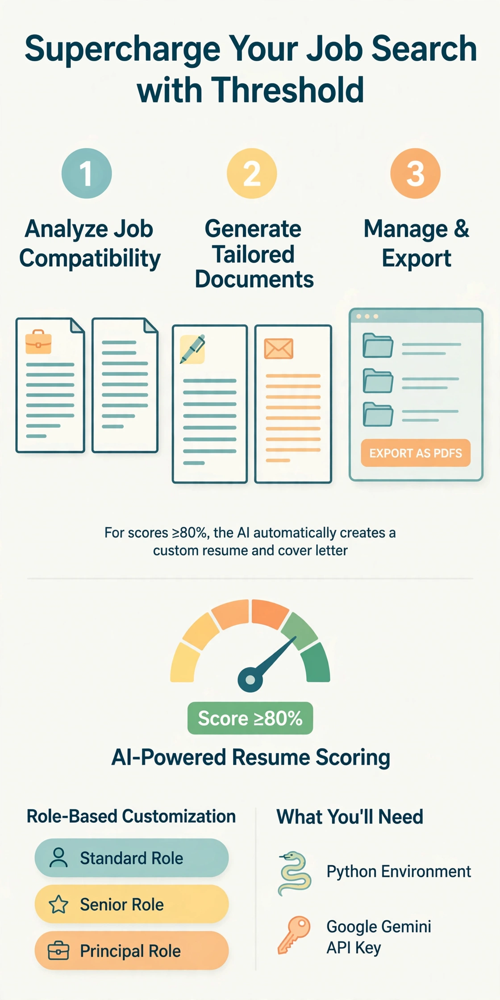

# Threshold

A governed resume-tailoring system that refuses to produce low-confidence output.

[License: Dual MPL-2.0/Commercial]

---

## Why governed?

Threshold is a governed resume-tailoring system designed around AI failure modes. Tailoring only occurs when job compatibility meets a configurable threshold, and all generated content must remain grounded in the source resume.

Most resume tools say "generate better resumes." Threshold says the system can refuse to generate. Three rules enforce that:

- **Threshold gate.** Tailoring only runs when the match score meets the configured threshold (default 80%). Below it, tailoring is disabled to prevent poor-quality results. A resume tool that tells you no.
- **Factual grounding.** The AI is instructed to use only information from the source resume, and the prompt includes a self-check asking it to remove anything not supported by the original before outputting. It does not add experience, invent details, or oversell.
- **Output constraints.** Tailored resumes follow a fixed structure (standard sections, single column, no tables) and are designed to fit 2 pages.

The AI proposes. Rules and humans dispose.

---

## Overview

Threshold analyzes job descriptions against a source resume, applies governance controls, and produces tailored application materials only when compatibility meets a configurable threshold.

Key Features:
- Configurable minimum match threshold through GUI settings
- AI-powered resume compatibility scoring
- Intelligent resume and cover letter tailoring
- Job import from external sources (LinkedIn, Email, Plain Text)
- Job description storage for future reference
- Multiple export formats (PDF, Word, Plain Text, ATS-Optimized)
- Role-based customization for different position levels
- Enhanced custom prompt management with template validation
- Built-in prompt examples and variable preview functionality
- Professional PDF export capability
- Modern, themed UI with improved visual design
- Enhanced user experience with better layouts and styling

---

## Quick Start

### Step 1: Install Dependencies
```bash
pip install -r requirements.txt
```

### Step 2: Configure API Key
```bash
cp .env.example .env
# Edit .env and add your GEMINI_API_KEY from https://aistudio.google.com/apikey
```

### Step 3: Launch Application
```bash
python gui/tkinter_app.py
```

---

## Visual Guides

### Application Icon

The Threshold application icon.


### Workflow Diagram

Visual representation of the Threshold workflow from job analysis to tailored application materials.



---

## How It Works

### 1. Analyze Job Compatibility
- Paste the job description (minimum 100 characters)
- Click "Analyze Match" to get your compatibility score
- Review detailed feedback on strengths and improvement areas

### 2. Tailor Your Application Materials
- For scores meeting or exceeding the configured threshold (default 80%), the "Start Tailoring" button becomes available
- AI generates a customized resume and cover letter
- All materials are automatically saved to the output folder

### 3. Import Jobs from External Sources
- Use the "Import Job" tab to import job descriptions from:
  - Plain text
  - LinkedIn job postings (HTML source)
  - Email content
- Automatically parses job titles, companies, and descriptions

### 4. Customize AI Prompts
- Use the "Custom Prompts" tab to create and manage custom prompt templates
- Load built-in examples as starting points for your custom prompts
- Preview how variables will be substituted in your prompts
- Save custom templates for specific roles or companies

### 5. Manage and Export Your Documents
- View previously tailored applications in the "Tailored Documents" tab
- Export your materials in multiple formats:
  - PDF (professional formatting)
  - Word (.docx)
  - Plain Text (.txt)
  - ATS-Optimized (for Applicant Tracking Systems)
- Resumes are designed to fit 2 pages. If a PDF export runs over, the app offers to condense it: the AI suggests specific cuts or rewrites (oldest and least relevant first), you check the ones you want, and the revised resume is saved back automatically.
- Delete tailored documents selectively:
  - Delete only resume and cover letter (job description preserved by default)
  - Option to delete all files including job description

---

## Configuration Options

### Minimum Match Threshold
Adjust the minimum compatibility score required to enable tailoring:

#### Using the GUI (Recommended Method)
Access the **Settings** tab in the application to configure the match threshold:

1. **Slider Control**: Drag the slider to adjust the threshold from 50% to 95%
2. **Manual Entry**: Enter a specific percentage value in the text field
3. **Real-time Feedback**: Current threshold value is displayed dynamically
4. **Apply Changes**: Click "Apply Changes" to save your custom threshold
5. **Reset to Default**: Use "Reset to Default (80%)" to restore the recommended setting

#### Direct Code Modification (Advanced)
Edit the value in `config/settings.py`:
```python
# In config/settings.py
MIN_MATCH_THRESHOLD = 80  # Default: 80%
```

#### How Match Threshold Works
The match threshold determines when the "Start Tailoring" button becomes available:
- **Match Score ≥ Threshold**: Tailoring is enabled
- **Match Score < Threshold**: Tailoring is disabled to prevent poor-quality results

#### Threshold Strategy Guidelines
- **70-75%**: Aggressive job applications (lower match tolerance, more opportunities)
- **80%**: Balanced approach (recommended default for most users)
- **85-90%**: Conservative applications (higher match requirements, fewer but better-targeted applications)

#### Best Practices
1. Start with the default 80% threshold
2. Adjust based on your job application results
3. Lower thresholds (70-75%) for broader opportunities
4. Higher thresholds (85-90%) for targeted, high-match applications
5. Monitor the detailed match analysis to understand score factors

### Role Levels
Choose the appropriate role level for optimal tailoring:

1. **Standard**: Entry to mid-level positions (0-5 years)
2. **Senior**: Senior-level positions (5-10 years)
3. **Lead**: Lead positions (8-15 years)
4. **Principal**: Principal/architect positions (12+ years)

Select the level that best matches the position requirements.

---

## Building Standalone Executable

```bash
# Install PyInstaller
pip install pyinstaller

# Build cross-platform executable
python build_standalone.py
```

---

## Troubleshooting

Common issues and solutions:

- "API key not found": Ensure .env file contains your GEMINI_API_KEY
- "No active resume": Upload and set a resume as active in the Resume Management tab
- "Match analysis failed": Job description must be at least 100 characters

---

## Licensing

Threshold is available under two licensing options:

### Open Source (MPL-2.0)
- Free to use, modify, and distribute
- Modifications must be open-sourced
- Perfect for individual users and open-source projects

### Commercial License
- Paid license required for proprietary use
- No requirement to open-source modifications
- Includes priority support and additional features
- Ideal for businesses and enterprise use

For commercial licensing inquiries, please contact via https://github.com/Micouwr.

See LICENSE_MPL.md and LICENSE_COMMERCIAL.md for complete license terms.


